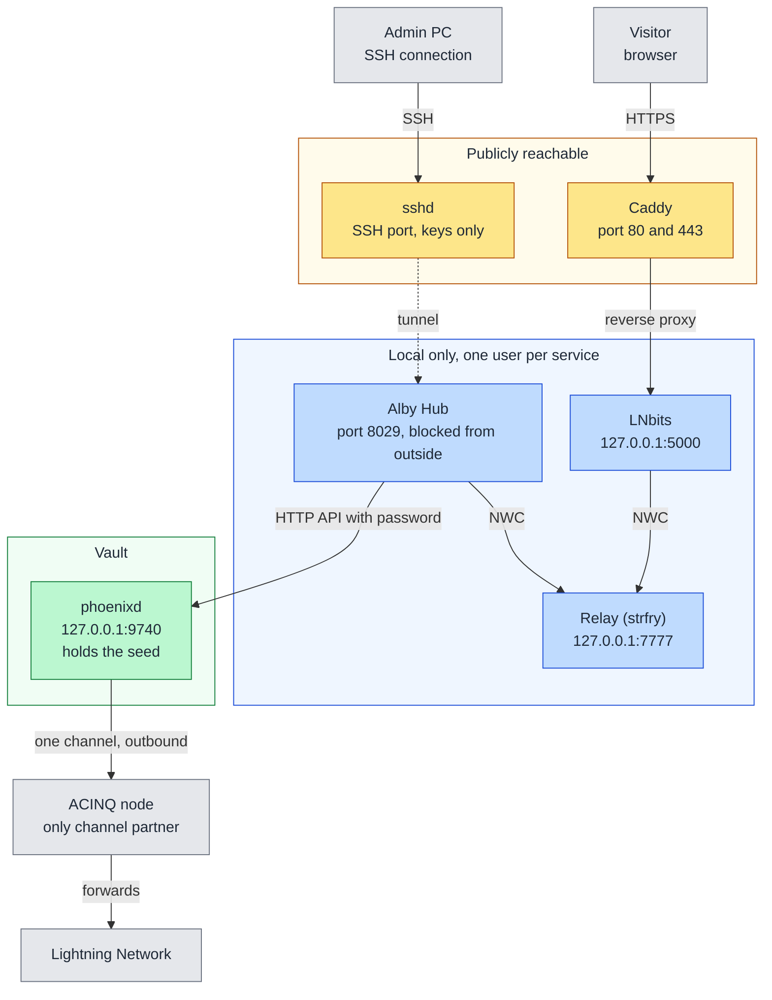

# Phalnx

**Hardened Lightning stack: phoenixd + Alby Hub (NWC) + Nostr relay + LNbits on a single VPS.**

Phalnx is a step-by-step guide that walks you from a fresh Ubuntu 24.04 server to a running, locked-down Lightning
stack, and shows you how to check every step, update it and react when something goes wrong.

**Read it here: https://phalnx.21mio.space** (currently in German, English will follow)

## What is Phalnx?

Running a Lightning service such as [LNbits](https://lnbits.com) means putting a web application with many
extensions next to real money. No such application can be proven free of bugs. Phalnx is built around one
question: **what if one part gets compromised?** The answer is a layout where each component can only reach what
it must, and where the funds sit behind a spending limit.

The stack:

| Component | Role |
|---|---|
| **[phoenixd](https://phoenix.acinq.co/server)** | The Lightning node. Holds the seed and one channel to ACINQ. The only part that ever sees the seed. |
| **[Alby Hub](https://albyhub.com)** | Controls phoenixd and hands out **NWC** (Nostr Wallet Connect) connections with a **budget**. Reachable only through an SSH tunnel. |
| **Relay ([strfry](https://github.com/hoytech/strfry))** | A local Nostr relay that carries the NWC messages between Alby Hub and LNbits. Not reachable from outside. |
| **[LNbits](https://lnbits.com)** | Web interface with wallets and extensions. Pays only over NWC, within the budget. |
| **[Caddy](https://caddyserver.com)** | Reverse proxy with automatic HTTPS. Exposes only LNbits and puts an extra password in front of its admin area. |

## How it fits together

Only SSH and Caddy are reachable from the internet. Everything else listens locally, and every service runs as
its own Linux user. LNbits never talks to phoenixd: a payment goes through the relay to Alby Hub, which checks
the budget first. Even if an attacker takes over LNbits, they can spend only what the NWC connection allows.



Yellow is publicly reachable, blue runs only locally, green is the vault with the seed. The dashed line goes
through the SSH tunnel. phoenixd has exactly one channel, to the ACINQ node, which forwards payments. That makes
your node a hidden (private) node.

## What you get

- **One Linux user per service**, home directories `700`, secrets `600`, systemd sandboxing.
- **Firewall rules per user**: LNbits cannot reach the phoenixd API, even locally.
- **Hardened SSH**: key only, no root, custom port, Fail2ban. Second Fail2ban jails for the LNbits login.
- **Spending limit**: LNbits pays through NWC with a budget set in Alby Hub.
- **Automatic Ubuntu updates** at fixed times, with a fixed reboot time, and a reboot test that proves all services
  come back on their own.
- **Checks after every step**, a final checklist, update instructions for every component, and an emergency
  chapter (including how to close the channel and move the funds).
- **Optional**: Telegram notifications for larger payments, and a nightly backup (dated archives in a rotating
  store, optionally encrypted with `age` for download).
- **"My values" panel** (labelled "Meine Werte" in the German guide): enter your IP, SSH port, domain and so on once, and every command in the guide, including
  the copy button, uses your values. They stay in your browser.

## The guide

| Part | Content |
|---|---|
| **Intro** | Security principles, what each application does, architecture, preparation |
| **A: Server foundation** | First login, swap, admin user, SSH keys, SSH hardening and firewall, Fail2ban, automatic updates, service users |
| **B: Services** | SSH tunnel, phoenixd, Alby Hub, local relay, LNbits, Caddy, Fail2ban for the web UI, per-user port rules |
| **C: Acceptance and operation** | Reboot test, checklist, updates, secrets and backups, daily use, emergency |
| **D: Optional** | Telegram notifications, nightly backup |

## Language

The guide itself is currently **German only**, including the interface labels such as the "Meine Werte" button.
English will follow. Repository structure, file names and
the server file names used in the guide are English.

## Support

If the guide helps you, you are welcome to send a few sats: `axelhamburch@21mio.space` (Lightning address).

## Development

Requires Node.js 20 or newer.

```bash
npm install
npm run dev      # local server on http://localhost:4321
npm run build    # static site to dist/
npm run preview  # serve dist/ locally
```

`npm run build` first stamps the current Bitcoin block height from mempool.space into the page header
(`build: <height>`), then writes to `dist/`. Always use `npm run build`, not `astro build`. Upload the **contents**
of `dist/` to your web server.

## Structure

```text
src/
├── content/docs/            pages (Markdown), one folder per part
│   ├── start/               intro: security, overview, preparation
│   ├── server/              part A: server foundation
│   ├── services/            part B: phoenixd, Alby Hub, relay, LNbits, Caddy ...
│   ├── operations/          part C: acceptance, updates, emergency
│   └── optional/            part D: optional add-ons (Telegram notifications, nightly backup)
├── config/placeholders.ts   placeholders for the "My values" panel
├── config/apps.ts           application descriptions (tiles, popup, overview page)
├── config/build.json        build stamp (block height), written by scripts/stamp-build.mjs
├── scripts/                 client logic (placeholders panel, diagram and logo zoom)
├── components/              header, footer and start page components
└── styles/custom.css        look of panel and highlights
scripts/stamp-build.mjs      writes the block height before every build (`npm run build`)
astro.config.mjs             title, language and sidebar
```

Sidebar order and labels live in `astro.config.mjs`. Diagrams are written as ` ```mermaid ` blocks and
rendered in the browser (`astro-mermaid`).

## Placeholders (the "My values" panel)

Pages contain changeable values as `__KEY__`, for example `__SSH_PORT__`, `__SERVER_IP__` or `__DOMAIN__`.
The **My values** button in the header (labelled **Meine Werte** while the guide is German) lets the reader set them. The browser replaces them in text, code
blocks and the copy button. Values are stored in `localStorage` only.

Add a placeholder:

1. Add an entry in `src/config/placeholders.ts` (key, label, default, allowed pattern).
2. Use `__NEW_KEY__` in the pages.

Rules:

- Keys: **UPPERCASE, digits and `_`** only. Otherwise the syntax highlighter splits the token.
- In running text always wrap `__KEY__` in `backticks`, otherwise Markdown renders it bold.
- `pattern` is a **whitelist**. Values end up in shell commands, so spaces, quotes, `;`, `|` and `&` are
  not allowed.
- No placeholders in code titles (`title="..."`). They are not replaced there.

## Writing content

- Pages are Markdown (`.md`), file names and URL slugs in English. Admonitions: `:::note`, `:::tip`,
  `:::caution`, `:::danger`.
- Each page follows the pattern: goal, commands in separate blocks, **check**, **if it fails**.
- Commands that must wait for each other go into **separate code blocks**.
- Only panel values or dummies appear in the guide: no real IPs, domains or credentials. Use the
  documentation range `203.0.113.0/24` for IPs and `example.org` for domains.
- Server file names used in the guide are English (for example `00-hardening.conf`, `nft-local.service`).
- Untested commands go into a caution box titled "Nicht getestet" (`:::caution[Nicht getestet]`, German like the rest of the guide).

## License

MIT, see [LICENSE](LICENSE).
