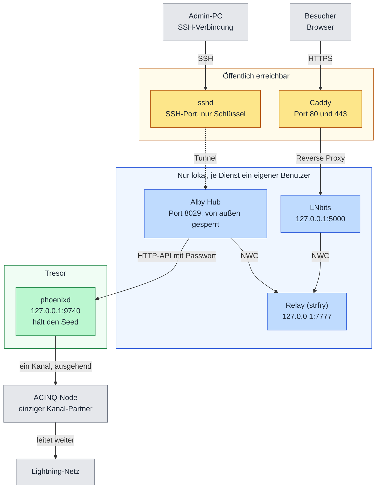
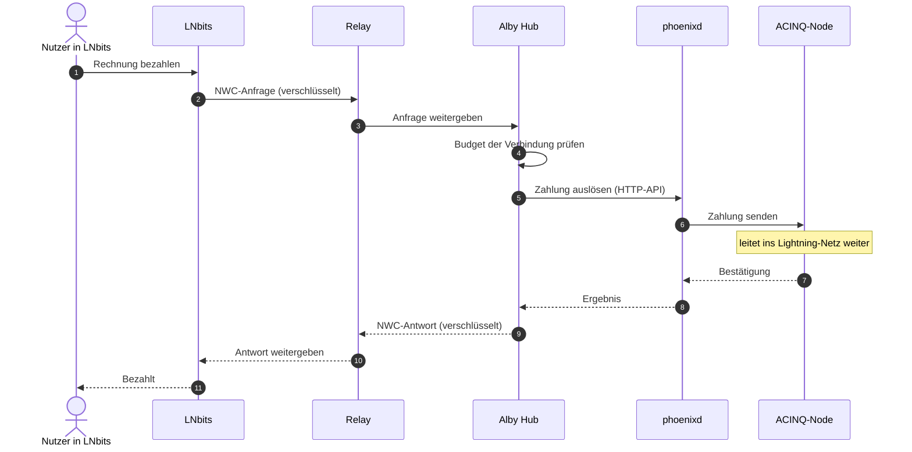

## Die Bausteine

Das Bild zeigt den VPS mit seinen Bereichen. Pfeile sind erlaubte Verbindungen. Wo kein Pfeil ist, können zwei
Bausteine nicht miteinander reden.



**Farben:** Gelb ist öffentlich erreichbar, Blau läuft nur lokal auf dem Server, Grün ist der Tresor mit dem
Seed. Gestrichelte Linien laufen **durch den SSH-Tunnel**. Du erreichst Alby Hub also nie über eine Webseite
im Internet.

phoenixd spricht **nicht** selbst mit dem Lightning-Netz. Es hat genau **einen Kanal zum Node von ACINQ**, dem
Anbieter von phoenixd, und ACINQ leitet Zahlungen weiter. Dein Knoten ist damit ein **versteckter** (privater)
Knoten: Er ist im Netz nicht öffentlich angekündigt und nimmt keine Verbindungen von außen an.

### So läuft eine Zahlung

Wenn jemand in LNbits eine Rechnung bezahlt, spricht LNbits nie direkt mit phoenixd. Die Anfrage geht über
den Relay an Alby Hub, und nur Alby Hub darf phoenixd ansprechen.



Das **Budget** in Schritt 4 begrenzt den Schaden: Wer LNbits übernimmt, kann nur so viel ausgeben, wie die
NWC-Verbindung erlaubt.

### Die Bausteine im Einzelnen

| Baustein | Aufgabe |
|---|---|
| **phoenixd** | Der Lightning-Knoten. Hält Seed und Kanal. |
| **Alby Hub** | Steuert phoenixd und vergibt NWC-Verbindungen mit Budget. Nur über einen SSH-Tunnel erreichbar. |
| **Relay (strfry)** | Leitet die NWC-Nachrichten lokal weiter, ohne Umweg über das Internet. |
| **LNbits** | Weboberfläche mit Wallets und Erweiterungen. Zahlt nur über NWC, mit Budget. |
| **Caddy** | Macht nur LNbits öffentlich, mit HTTPS und Passwortschutz für den Admin-Bereich. |

Alby Hub und LNbits sprechen **nie direkt** miteinander. Beide verbinden sich ausgehend zum Relay.
LNbits schickt eine verschlüsselte Anfrage an den Relay, der Relay gibt sie an Alby Hub weiter, die
Antwort läuft auf demselben Weg zurück. Der Relay kann den Inhalt nicht lesen.

## Namen und Vorgaben

Die Namen in der Tabelle kannst du ändern. Admin-Benutzer, Servername und SSH-Port stellst du über
**Meine Werte** ein, die Dienst-Benutzer bleiben in dieser Anleitung fest.

| Was | Name | Zweck |
|---|---|---|
| Server | `__HOSTNAME__` | Hostname |
| Admin-Benutzer | `__ADMIN_USER__` | Der einzige Benutzer, der sich per SSH anmeldet und `sudo` darf |
| Dienst-Benutzer 1 | `uphoenixd` | Nur für **phoenixd** (hält den Seed) |
| Dienst-Benutzer 2 | `ualbyhub` | Nur für **Alby Hub** |
| Dienst-Benutzer 3 | `ulnbits` | Nur für **LNbits** |
| Dienst-Benutzer 4 | `urelay` | Nur für den **lokalen Relay** |
| SSH-Port | `__SSH_PORT__` | Statt 22 |

Das Präfix `u` steht für „User des Dienstes". Der Admin-Benutzer muss immer von den Dienst-Benutzern getrennt
sein.

## Ports

| Port | Adresse | Programm | Erreichbar für |
|---|---|---|---|
| `__SSH_PORT__` | alle | sshd | alle (mit Schlüssel) |
| 80, 443 | alle | Caddy | alle |
| 9740 | 127.0.0.1 | phoenixd | `ualbyhub`, `uphoenixd` |
| 8029 | von außen durch die Firewall gesperrt | Alby Hub | `ualbyhub`, Admin nur über den SSH-Tunnel |
| 5000 | 127.0.0.1 | LNbits | `ulnbits`, `caddy` |
| 7777 | 127.0.0.1 | Relay | `urelay`, `ualbyhub`, `ulnbits` |

phoenixd verbindet sich selbst **ausgehend** mit dem Node von ACINQ (Port 9735) und hält dort seinen einen Kanal.
Dafür musst du auf dem Server nichts öffnen. Die Firewall erlaubt ausgehenden Verkehr ohnehin. Eine Regel
brauchst du nur, falls du ausgehende Verbindungen selbst einschränkst.

## Reihenfolge nach einem Neustart

```text
phoenixd  →  relay  →  albyhub        lnbits (5 Sekunden später, ohne Abhängigkeit)
```

Alby Hub startet erst, wenn phoenixd und der Relay da sind. LNbits hängt **absichtlich nicht** von ihnen ab.
So lässt sich die Finanzierungsquelle jederzeit umstellen, ohne dass ein gestoppter Dienst LNbits mit
blockiert. Eine feste Wartezeit von 5 Sekunden gibt den anderen einen kleinen Vorsprung.

## Die Entscheidung: ein Server für alles

phoenixd, Alby Hub, LNbits und der Relay laufen auf demselben Server. Das spart Kosten. Das Restrisiko
(Root-Übernahme, Kernel-Lücke oder SSH-Fehler trifft alles) besteht aber auch bei einem Server nur mit
Alby Hub. Es wird mit wenig Guthaben und der Härtung in dieser Anleitung klein gehalten.

## Der Weg durch die Anleitung

1. **Teil A** richtet den Server ein und härtet ihn.
2. **Teil B** installiert die Dienste in der Reihenfolge phoenixd, Alby Hub, Relay, LNbits, Caddy.
3. **Teil C** prüft alles, zeigt Updates und den Notfall.
4. **Teil D** ist optional: Telegram-Benachrichtigungen und das nächtliche Backup.

Warum Caddy erst zuletzt kommt: Alby Hub und LNbits legen beim **ersten Aufruf** das Admin-Konto an. Wer die
Seite zuerst öffnet, wird Admin. Deshalb machst du die Ersteinrichtung über den SSH-Tunnel, bevor etwas
öffentlich ist.

Weiter mit der [Vorbereitung](/start/preparation/).
